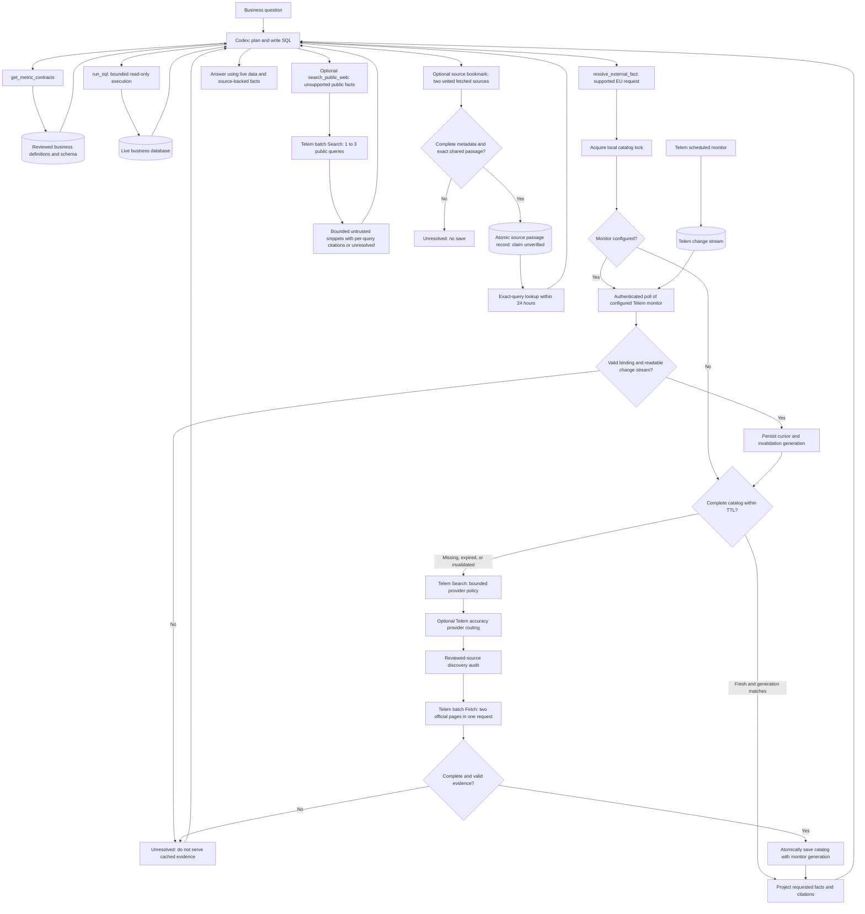
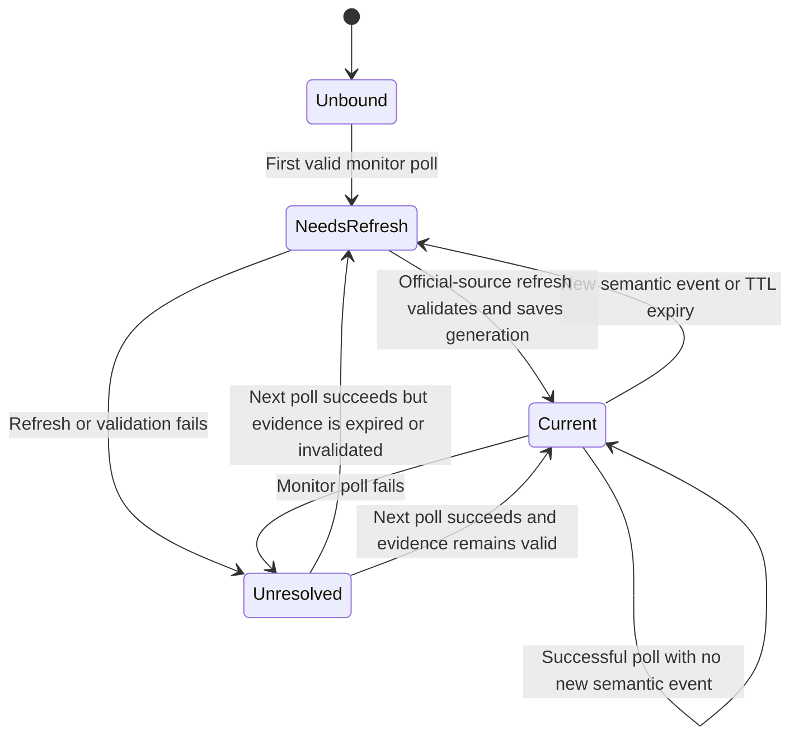

# Architecture

Codex plans the work and writes SQL. The MCP supplies reviewed business definitions,
live read-only database access, and reusable public evidence. There is no hidden
manager LLM and no cache of final answers.

## Complete request path

The diagram shows the optional monitor path. Without a configured monitor, TTL is
the freshness gate. With a monitor, each supported resolver request polls it before
reading cached evidence. This is **poll-on-access**, not an incoming webhook or a
background worker inside the MCP.

## What happens in each component

1. **Business catalog:** returns formulas, units, dependencies and population rules.
   It does not fetch business rows or prove that the agent's SQL follows those rules.
2. **Database tool:** executes agent-authored read-only SQLite SQL with a timeout,
   bounded rows and explicit truncation. Business data remains live.
3. **Evidence resolver:** accepts current EU membership and reviewed country names.
   A valid warm entry returns only requested facts, passages and provenance.
4. **Telem retrieval:** refresh uses a public query and fixed official source family.
   Optional accuracy routing lets Telem select within the provider allowlist.
   Candidate RRF is audit metadata; it does not choose which pages are fetched.
5. **Validation and persistence:** both complete official listing pages and the
   reviewed 27-member set are required. Valid evidence is saved atomically, with a
   revision hash and retrieval time. A changed member set requires review.
6. **Monitor invalidation:** a configured monitor supplies a change signal, not new
   fact evidence. Relevant stream events advance a durable generation. Evidence
   saved under an older generation is unusable until refreshed and validated.

## Monitor state and failure handling

The local `.monitor.json` sidecar stores monitor ID, cursor and generation. Cursor
updates are persisted before refresh. Replayed old events do not invalidate again.
A shared file lock serializes polling and refresh among cooperating local server
processes. This is not a distributed lock across independent hosts or filesystems.

Monitor mode hides the legacy full-list and projection tools so an agent cannot
bypass the monitor gate. An inactive or mismatched monitor, malformed stream,
excessive backlog, or polling outage returns `unresolved`. It does not fall back to
serving a cached fact merely because its TTL has not expired.

## Trust boundaries and limits

- Telem receives the fixed public query and official URLs, not private business rows
  or the user's full question. Credentials come from the environment and are not logged.
- Monitor requests authenticate to an approved Telem origin. No public webhook
  endpoint is exposed in this implementation.
- TTL remains a backup when a monitor misses a change. A monitor notification is
  not proof a fact changed, and an absence of notifications is not proof it did not.
- Detection is delayed by the monitor schedule and polling. A change can occur
  after a poll. Neither this feature nor a fresh retrieval guarantees zero stale data.
- Current external-fact coverage is EU membership only. The cache is trusted local
  operator state, not a tenant-isolated enterprise store.
- Monitor polling adds API calls even on warm hits. Earlier zero-call warm results
  measured monitor-disabled operation; do not reuse them as monitor-mode results.

## Implementation map

| Module | Role |
| --- | --- |
| `server.py` | MCP tools and opt-in configuration |
| `metric_contract.py` | Reviewed metric definitions and original-source checks |
| `sql.py` | Read-only SQL execution and result limits |
| `evidence_resolver.py` | Freshness, refresh, validation and evidence projection |
| `monitor_invalidation.py` | Authenticated polling, durable cursor/generation, local file lock |
| `telem_provider.py` | Bounded Telem search/fetch and optional provider routing |
| `discovery_audit.py` | Candidate deduplication, provenance and audit-only RRF |
| `eu_catalog.py` | Official-page parsing, source hashes and TTL |

See [monitor setup and verification](monitor-invalidation.md),
[measured resolver results](resolver-results.md), and [routing guide](telem-routing.md).

## Unsupported public facts

The opt-in [public web fallback](public-web-fallback.md) is agent-driven, not an
automatic widening of the EU resolver. It batches independent public queries and
returns unverified source snippets. It never writes into the reviewed EU cache.
