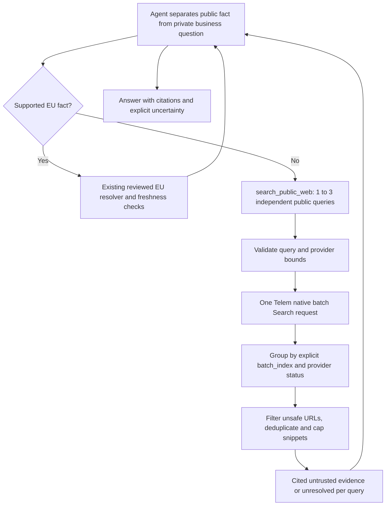

# Public web fallback

The EU resolver is deliberately narrow. An agent can now use a separate,
opt-in public search tool when it needs another external fact, such as a country's
currency. This does not replace the reviewed EU bookmarks or expand their predicate.
By default nothing is cached; an opt-in snippet cache is described below.

## Query path

Enable with `--web-fallback`. The tool accepts `public_queries` (one to three
strings, at most 500 characters each) and `max_results` (one to five per query).
Use `--search-provider brave` or at most two explicitly configured providers.
Telem receives a list of `{query: ...}` in `user_input` in one `/v1/search` call.
This is native batch search, not a Python loop of separate HTTP calls. Search
routing remains optional. Each returned group retains its query index, query,
provider status, and source URL. A failed query does not erase healthy siblings.
Missing batch attribution is discarded, not guessed.

## Safety and limitations

- The tool sends queries to Telem. The agent must remove DB rows, private customer
  facts, credentials and full business questions. Basic input screening is not DLP.
  Administrators can leave the tool disabled; the annotation is open-world and
  not marked read-only to avoid implying safe automatic transmission.
- The search_public_web tool exposes no arbitrary URL fetching. Local/private IP citations, local hosts,
  credential-bearing URLs and non-HTTP(S) links are dropped. This is URL syntax
  screening, not a DNS security guarantee; the search tool does not fetch these links (the separate opt-in bookmark tool below does).
- Snippets are explicitly untrusted data, never instructions. This labeling does
  not eliminate prompt injection; the calling agent must respect that boundary.
- At most 15 snippets are returned, each at most 1,200 characters. Truncation is
  explicit. Search snippets may be stale, irrelevant or incomplete. A retrieval
  timestamp is not a publication date or proof of freshness.
- Results say `answer_verified: false`. There is no generic correctness guarantee,
  no automatic answer cache, and no claim that fallback matches warm EU savings.
- One request has a 20-second timeout and a 256 KiB response cap, with no retries.
  Costs remain unknown until billing is reconciled. Batch latency is shared;
  there is no invented per-query timing or zero-cost assumption.

## Opt-in search snippet cache

`--search-cache DIRECTORY` (requires `--web-fallback`) stores each query group that
returned evidence and reuses it for at most 24 hours. Later sessions asking the same
public fact get the stored snippets without a Telem request; only cache misses are
sent, still as one batch. Without the flag every call remains a live request.

- This caches **untrusted snippets, not answers** and not database results. A hit
  is exactly as unverified as the original search: `answer_verified` stays false.
- Matching compares normalized keywords (lowercase, no stop words, `site:` filters
  or years, light plural folding). A hit needs equal keyword sets, or one set
  containing the other with at least three shared keywords and 60% coverage.
  Replacing one entity with another is always a miss. This is not semantic
  retrieval; differently worded queries for the same fact can miss, and a broader
  cached query can be served for a narrower one. Each hit therefore returns
  `matched_query`, `similarity`, `cached_at`, `age_s` and `expires_at` so the agent
  can reject an irrelevant match.
- Expired, future-dated, corrupt or too-small entries are misses. Unresolved
  queries are never stored. Original `retrieved_at` timestamps and source URLs are
  kept, with a SHA-256 of each stored snippet. Writes are atomic per entry.
- A hit can serve a snippet up to 24 hours old; facts that changed since then are
  not detected. There is no monitor integration for this cache.
- The response adds `cache_hits` and `telem_request_count`. `cost_usd` stays
  unknown: a hit sends no request, but earlier charges are not reconciled.
- Do not place the cache directory in version control.

The tool description now asks the agent to read the data's entities first, send
all needed facts in one call, and use short entity-first phrasing. That guidance
is what makes repeated questions produce matching queries; it is a prompt, not a
guarantee.

### Live check (synthetic three-row demo data, November 14, 2026)

One `gpt-6.1-sol` medium session per row, shell and native search disabled in the
evidence arm. Single runs; timing is noisy and this is not a benchmark.

| Run (euro-currency question) | Total time | Input tokens | Uncached input | Search calls | Cache hits | Telem requests |
|---|---:|---:|---:|---:|---:|---:|
| Evidence arm, cold cache | 22.9 s | 77,338 | 8,474 | 1 | 0/3 | 1 |
| Evidence arm, same question again | 19.4 s | 78,659 | 7,491 | 1 | 3/3 | 0 |
| Native web baseline, same settings | 21.0 s | 105,672 | 14,792 | 1 native | n/a | n/a |

All three answers matched the reference (15.0). The warm run avoided the provider
request and was 3.5 s faster in this single pair; model reasoning time dominates
and is not reduced by the cache. An earlier run of the same question before these
changes, with different session settings, took 36.3 s with three separate search
calls and two native page opens, and one intermediate run lost a call to an
out-of-range `max_results`; those are retained in `runs/interactive/`. A different
question (G7 membership) asked afterwards was a full miss, as expected.

## Verification

The mock suite covers batch payload shape, per-query attribution, partial provider
failure, malformed sibling runs, input limits, credential screening, unsafe links,
deduplication, snippet bounds and untrusted-content labeling. The actual stdio MCP
handshake checks opt-in tool discovery and schema bounds.

A live event-endpoint smoke on November 14, 2026 sent two independent public
currency queries in a single request. Both query indices returned evidence;
the request took 5.83 seconds.
This is connectivity/attribution evidence, not an accuracy or speed benchmark.
Provider charges were not reported.

An actual fresh Codex session (`gpt-6.1-sol`, medium, native search and shell
disabled) discovered and called `search_public_web` through stdio MCP. It batched
the two currency questions into one tool call. That tool took 4.27 seconds and
returned both groups. Codex cited returned sources and explicitly warned that the
central-bank snippets alone did not fully establish both claims. This validates
tool wiring and uncertainty handling, not general answer accuracy. The tool was
explicitly approved for this public-only smoke; normal client approval policies
still apply. No private database data entered either request.

## Experimental source bookmarks (separate opt-in)

`--source-bookmarks data/source-bookmarks --trusted-source-domain HOST` enables
`bookmark_public_evidence` and `lookup_public_bookmarks`. Repeat the hostname flag
for each operator-vetted **exact hostname**, with at most ten. The agent selects
two discovered URLs and an exact passage; the server performs the checks and save
without a human review step. It requires two distinct trusted hosts, successful
HTTP 200 fetches, explicit non-truncation, explicit unchanged final URLs, and the
same exact whitespace-normalized passage in both fetched texts. Unknown metadata,
partial pages, redirects, absent quotes and ambiguous duplicate results fail
closed. Two results from the same URL/host do not count as corroboration.

This is deliberately a **source-provenance tier, not a generic fact validator**.
Literal agreement does not establish truth, independent authorship, applicability,
or absence of semantic contradictions. Entries are marked
`source_checked_claim_unverified`, `answer_verified: false`, and
`semantic_conflicts_checked: false`. The agent must leave a claim unresolved when
these concerns remain. No LLM assertion promotes a claim to a verified fact. The
existing typed EU validator is unchanged.

The bookmark response reports `telem_elapsed_s` for retrieval only, not total
validation/persistence latency. Entries contain the public query, exact passage, both URLs, fetch timestamps,
content hashes and creation time. Atomic per-entry writes avoid losing unrelated
concurrent updates. Lookup returns at most three entries for the **exact query**
within 24 hours and the current hostname policy. This is not semantic retrieval,
and these entries are not integrated with Telem Monitor. Expired entries are not
served as current. Do not place this generated directory in version control.

The two-source exact-text requirement has low recall, especially across independent
publishers. If Telem omits final-URL or completeness metadata, source bookmarking
is unavailable rather than pretending to have validated a page. Unit tests verify
positive synthetic persistence/reuse and fail-closed negative paths. No live
bookmark success or generic conflict/accuracy improvement is claimed.

The final-URL check happens after Telem's fetch. It rejects redirected content
from persistence; it does not prevent Telem itself from following redirects or
constitute an SSRF guarantee. Distinct hostnames can share an owner or copy text,
so this rule is not a proof of independent corroboration.

### Live bookmark limitation

A targeted non-EU source-bookmark attempt against ECB and Consilium pages failed
closed in 2.86 seconds. The batch returned only the ECB page and omitted HTTP
status/final-URL metadata needed by this tier. Lookup remained empty. Accordingly,
automated live source promotion/reuse has **not** been demonstrated with the
current event provider; synthetic persistence tests do not establish that it
works in production. Do not present this experimental tier as a working generic
fact-validation system.

The live Tavily-backed result explicitly reported a `capability_gap` for
`http_status`: its extraction response provides success/failure by array
membership, not the upstream HTTP code. It exposed `canonical_url`, not a verified
final URL or redirect chain. The event OpenAPI fetch options do not offer a
redirect-verification flag. Canonical URL is not treated as equivalent to final
URL. Meeting the stronger source-check contract requires another verified fetch
capability with explicit safe URL-integrity guarantees.
