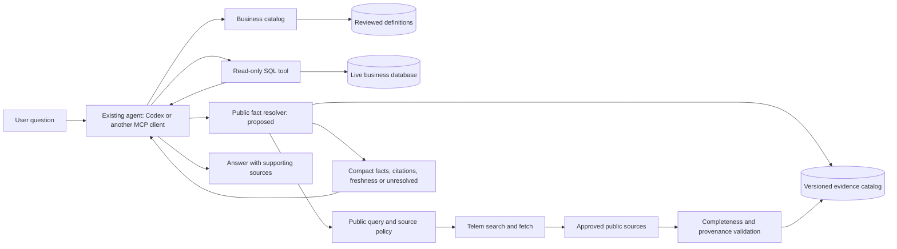
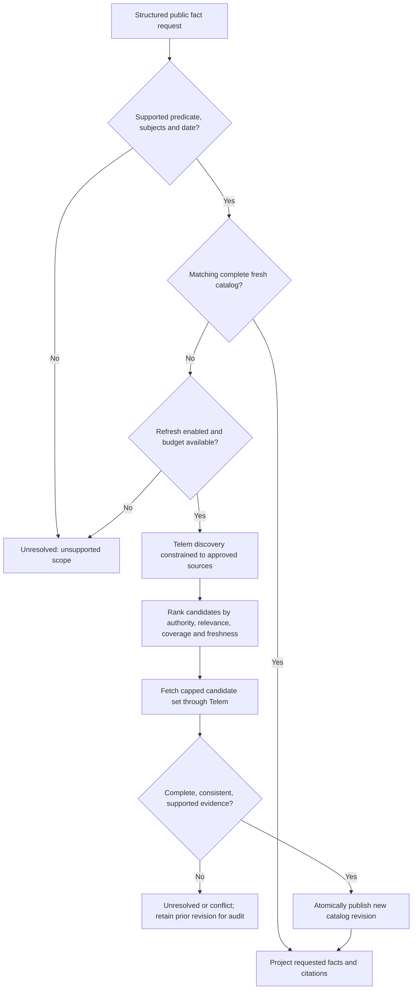
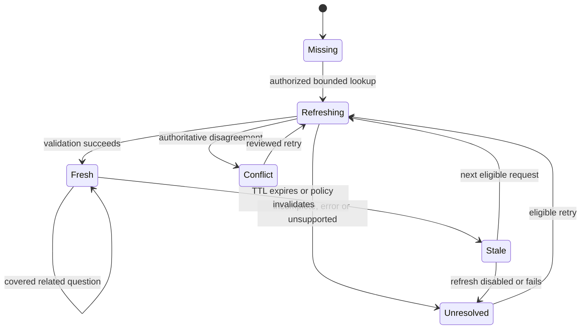

# Telem-backed evidence reuse: design and delivery plan

**Status: design for review and implementation.** This document is published before the next code change. Existing behavior, measured results, and proposed work are identified separately throughout.

## The product

Lesser Tokenzz is an MCP server for agents answering questions that combine live business data with public facts. It supplies business definitions and reusable, source-backed external facts, so the agent does not repeatedly reconstruct the same context.

For example, several questions may ask for revenue, engagement, or growth in EU countries. The SQL and answers change; the official membership evidence does not need to be rediscovered each time. We reuse that evidence, not the final answer or live database rows.

The next change closes a practical gap: **fresh evidence can be reused; stale or missing evidence must be refreshed through Telem or explicitly reported as unresolved.** A cache hit alone is not a correctness test.

## 1. What exists, and what changes

| Area | Current implementation | Next implementation |
| --- | --- | --- |
| Business context | Reviewed metric contracts, schema mappings, units, formulas, population rules | Preserve this interface; no new automatic claim of SQL correctness |
| Live data | Read-only SQLite queries with bounded execution and previews | Preserve existing protections |
| Public facts | Complete current EU membership catalog, built with two fixed official URLs | Add a bounded resolver for the same supported fact family |
| Telem | Authenticated search/fetch adapter; builder uses fetch only | Use discovery on missing/stale evidence, then fetch selected official sources |
| Freshness | 24-hour TTL; stale catalog returns a manual refresh instruction | Fresh hit returns facts; stale/miss triggers bounded refresh if enabled |
| Context size | Full catalog or optional requested-country projection | Compact fact results with citations; detail available separately |
| Failure | Manual fallback or unresolved | Explicit unresolved/conflict result; never silently return stale facts as current |
| Enterprise controls | Local process, environment credentials, read-only database | Narrow public-only inputs, source policies, budgets, redacted refresh audit records |

This is structured semantic fact reuse, not an embedding-based similarity cache. New subjects, predicates, aliases, or historical questions require supported adapters. We will not pretend the EU adapter already supports arbitrary business research.

## 2. Architecture

Only the public-query branch leaves the local service. Database rows, private metric definitions, the full user question, and credentials must not be included in search text or audit output. The agent remains responsible for reasoning and joining public facts with business data.

### Proposed tool contract

`resolve_external_fact(subjects, predicate, as_of, freshness)` accepts a small structured public fact request. The first supported predicate is current EU membership. `as_of` is optional; unsupported historical dates return unresolved rather than substituting current membership. Freshness policy has a configured upper age limit; the caller cannot relax it beyond operator policy.

A response contains:

- normalized facts for the requested subjects and a status;
- the scope and completeness of the supporting source set;
- supporting URL, short passage, retrieval time, source hash, and catalog revision;
- `fresh_hit` or `refreshed`, plus bounded diagnostic metadata;
- explicit unresolved subjects, missing evidence, or conflicts.

Do not return the entire fetched page by default. A separate evidence-detail path can expose the retained supporting passages for inspection. Provider payloads are not automatically agent context.

## 3. Resolution algorithm

1. Validate the request against the adapter's supported scope. Normalize only reviewed aliases; ambiguous names remain unresolved.
2. Check the catalog's scope, source policy, age, completeness and revision. Future-dated timestamps fail validation. A recently retrieved page does not prove that its contents are current.
3. On a fresh covered hit, return the minimum relevant evidence. Do not call another model or Telem for a routine hit.
4. On a miss or stale record, generate a public query from the controlled predicate and subjects. Never derive search text by copying a private question or SQL result.
5. Search approved domains through Telem. Bound query count, candidate count, fetch bytes, timeout and total refresh budget. Configuration must record the actual limits used in each experiment.
6. Select candidate sources using our deterministic policy. Telem provider ordering is not a guarantee that a passage proves the fact.
7. Fetch the selected source set and inspect warnings, truncation and coverage. For the EU adapter, require the complete official membership listing and agreement with its stated count. Do not hard-code a count as everlasting truth; unexpected changes require review before publication.
8. Validate and atomically write a new revision. Concurrent identical refresh requests should share one in-flight operation rather than duplicate provider calls.
9. Return compact facts with provenance. If refresh fails, keep the previous revision for audit but do not label it fresh. No silent stale fallback.

**Negative facts need stronger evidence.** A missing country from a partial page or failed name match is not proof of non-membership. A negative result requires a complete validated set and an unambiguous normalized subject. Contradictory authoritative sources return conflict, not a guessed answer.

### Freshness lifecycle

TTL is a policy, not an accuracy guarantee. Membership can use a longer window than rapidly changing prices or service status. The initial supported adapter keeps the existing 24-hour maximum. Source change monitoring and historical effective dates are later work, not implied by this TTL.

## 4. Telem's role

Telem provides the retrieval layer for rebuilding evidence. Our MCP supplies business scope, evidence validation, reuse policy and compact agent-facing context.

| Telem capability | Intended use | Delivery status |
| --- | --- | --- |
| Search with provider selection and domain filters | Find official source candidates for a supported missing fact | Adapter exists; resolver integration proposed |
| Fetch with provider fallback and normalized content | Retrieve selected evidence and inspect completeness warnings | Existing fetch path; bounded resolver integration proposed |
| Accuracy-oriented automatic routing | Select a suitable provider for discovery | Documented; must smoke-test on the hackathon endpoint before enabling |
| Batch queries and selected response fields | Avoid unnecessary request overhead and payload | Optional; add only if a measured use case benefits |
| Project keys, scopes, expiry and rate limits | Limit integration access and operational exposure | Deployment configuration; not proof of tenant isolation |
| Session-linked history | Correlate provider operations with a refresh | Optional; use opaque IDs, no private business text |
| Monitors and webhooks | Invalidate evidence when supported sources change | Future work, outside the first refresh loop |

Candidate ranking by authority, predicate relevance, coverage and freshness is **our policy**. We do not claim Telem implements fact-level reranking or verifies our conclusions. Documented features must be tested against the event deployment, since its schema may differ from general documentation.

Official references: [search parameters](https://docs.telem.ai/resources/search-parameters/), [fetch parameters](https://docs.telem.ai/resources/fetch-parameters/), [authentication](https://docs.telem.ai/authentication/), [configuration](https://docs.telem.ai/resources/config-reference/), [FAQ](https://docs.telem.ai/resources/faq/), [API reference](https://docs.telem.ai/api).

## 5. Security and trust boundaries

| Risk | Required control | Remaining limitation |
| --- | --- | --- |
| Private data sent to search | Structured public fact allowlist; no raw question, rows or metric definitions in outbound payload | A general free-text resolver would need a separate disclosure policy |
| Web prompt injection | Treat retrieved text as data; deterministic supported parser; never execute page instructions | Broader model-based extraction needs separate hardening |
| Malicious URLs or redirects | HTTPS source allowlist; validate final destination and redirects before accepting evidence | Provider behavior must be tested, not assumed |
| Stale or incomplete evidence | TTL, source metadata, completeness checks, explicit unresolved/conflict | Freshly fetched content can still be wrong or outdated |
| Cross-customer disclosure | Current local deployment; do not mix private caches across customers | Multi-tenant authentication, authorization and isolation are not built |
| Secret leakage | Environment credentials; redact headers and keys; no secrets in git or traces | Key rotation and production secret management are deployment work |
| Runaway costs | Hard search/fetch/time budgets; single-flight refresh; explicit retry policy | Provider fee reconciliation is still required |
| Wrong SQL or business logic | Read-only execution, reviewed contracts, bounded previews | Catalog context does not prove the agent follows the rules |
| Misleading audit trail | Record source revision, scope, hit/refresh status, timings and validation failures | An audit log is not an independent correctness certificate |

No claim of SOC 2 compliance, no-training guarantees, retention guarantees, or production-grade tenant isolation is supported by this prototype. Verify vendor terms and enterprise controls before processing sensitive customer data.

## 6. Evaluation

### Existing evidence, not a forecast

Six covered cross-source tasks were run with the same business catalog, comparing native live web search against a Telem-built warm EU catalog:

| Measure | Native search | Warm catalog |
| --- | ---: | ---: |
| Reference numerical matches | 6/6 | 6/6 |
| Total end-to-end time | 207.76 s | 169.70 s |
| Total input tokens | 1,180,860 | 612,846 |
| Cached input tokens, included above | 1,027,072 | 539,008 |
| Output tokens | 3,948 | 3,544 |

That is 18.3% lower warm elapsed time, 48.1% fewer input tokens and 10.2% fewer output tokens. Five cases were faster; one regressed. The catalog build required two Telem fetches and 16.44 seconds. These are one-run pilot results from the earlier implementation, not a new run of the cleaned package or the proposed automatic resolver. Numerical agreement alone does not validate every citation or SQL step. Provider fees remain unverified, so this table is not an all-in dollar savings claim.

A cold per-country approach was slower and failed to establish sufficient evidence. Optional evidence projection reduced payload size, but has not established an additional end-to-end gain. We retain these results rather than presenting every attempted approach as successful.

### Next matched test

Use 5–10 related questions selected before running the comparison. Keep model, reasoning level, database snapshot, business catalog, provider configuration, budgets and freshness policy fixed.

- **Control:** Telem live retrieval for each question, without reusable fact catalog.
- **Treatment:** the same Telem retrieval path plus validated evidence reuse and refresh.
- **Context-only reference:** existing native-search baseline, clearly labeled because it changes the retrieval provider as well.

Warm the treatment with a separate seed query. Do not warm it with benchmark answers or final SQL results. Follow-up questions should change the metric, grouping or filter while legitimately sharing the external fact dimension. Include covered hits, stale evidence, missing coverage and an out-of-scope request. Unsupported cases must not quietly disappear from results.

Record each exact question, prompt, tool schema/configuration, catalog revision, seed/build operation, answer and trace. Report:

1. End-to-end wall time and separately measured search/fetch time. Parallel call durations must not be summed and described as wall time.
2. Input, cached-input and output tokens. Cached input is a subset of input, not an extra quantity.
3. Provider calls, failures, retries, bytes and cache outcome.
4. Reference answer agreement, source support, scope/freshness compliance and unresolved cases.
5. Model cost using explicit pricing assumptions, plus actual provider fees when available. Unknown fees stay unknown.

Show per-case rows and totals, not just the best trace. Pick one typical warm-hit trace and one refresh/failure trace to demonstrate behavior. If time permits, repeat matched pairs and alternate order. A one-run pilot must remain labeled as such.

## 7. Business rationale and demo

**Initial customer hypothesis:** a data or AI platform team supporting analysts who repeatedly combine internal metrics with public classifications, market facts or eligibility rules. The buyer wants consistent definitions, fewer redundant research steps and inspectable evidence, not merely an MCP endpoint.

Start with a paid pilot for one repeated workflow, one database and one supported external fact family. A possible business model is a subscription for managed catalogs and governance, with metered refresh/provider usage. Validate willingness to pay and operational savings before claiming a large market or a defensible moat.

Existing semantic layers already govern metrics; enterprise search products already connect sources. Our proposed distinction is a reusable, freshness-governed external fact layer that agents can join to live data while receiving only the needed evidence. The durable value would come from reliable adapters, permissions, provenance and workflow integration. The protocol itself is not a moat.

**Hackathon demo:** ask a cross-source question, show the Telem-backed evidence build, then ask a different related question and show the validated reuse plus live SQL. Expire the evidence and show a real refresh or honest unresolved response. Display measured tokens, time, source links and the same answer checks for both conditions.

This addresses retrieval and grounded results through Telem, innovation through reusable evidence rather than final-answer caching, and venture potential through a specific repeatable analyst workflow. It does not require adding unrelated provider features to inflate an integration count.

## 8. Delivery sequence and acceptance checks

1. Publish this design document, with its diagrams, in a documentation-only commit.
2. Implement the scoped resolver in an isolated working copy. Keep provider transport, source policy, validation, storage and MCP presentation separate, with short comments explaining non-obvious rules.
3. Test fresh hits, expiry, future timestamps, invalid aliases, unsupported dates, incomplete pages, conflicts, provider errors, budget exhaustion and atomic-write failures. Verify no secrets or private rows appear in outbound requests or logs.
4. Smoke-test supported Telem features against the event endpoint. Keep optional auto-routing disabled if verification fails.
5. Run the matched pilot and publish the complete results, including regressions and limitations.
6. Push the tested code and results in clearly named commits after the design commit. Update `algo.md` to describe implemented behavior, not the entire roadmap.

The minimum successful change is a working, bounded fresh/stale evidence loop with a transparent reuse comparison. Arbitrary fact extraction, hosted multi-tenancy, compliance claims and an extensive enterprise platform remain outside this delivery.
